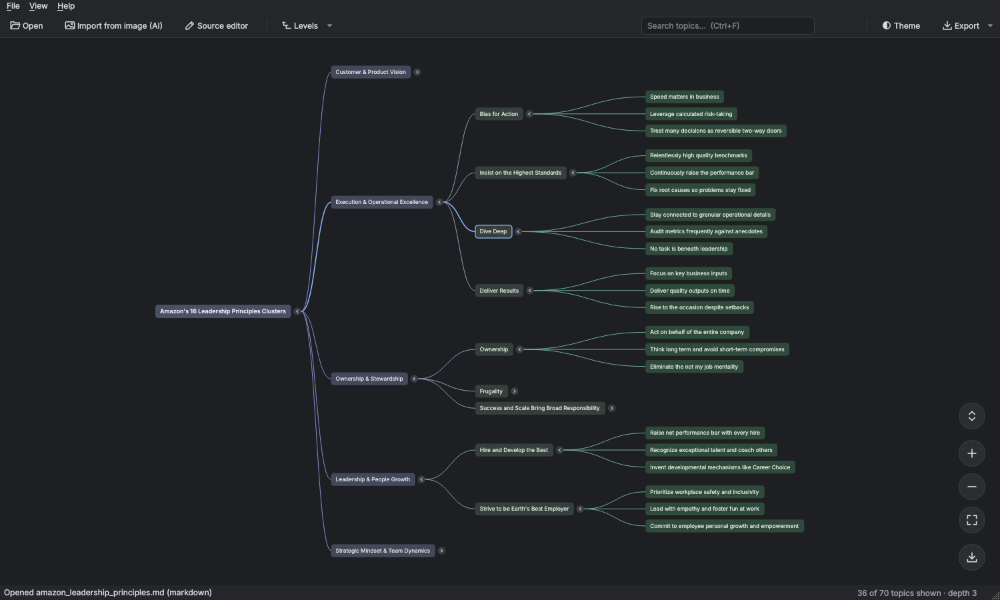

# Mind Map Viewer

A desktop app for **Windows and Ubuntu** that turns an outline or a mind map picture into an
**interactive, collapsible mind map**. It works like the NotebookLM mind map view: topics are laid
out left to right, you click the ‹ › circles to collapse or expand branches, and you can pan, zoom,
fit, expand all and export.

Written in Python with Qt (PySide6). It is a native app with no browser engine, and text files are
processed entirely on your machine.



---

## Quick start

### Windows
1. Install **Python 3.9+** from python.org and tick *“Add python.exe to PATH”*.
2. Double-click **`run_windows.bat`**. The first run creates `.venv` and installs PySide6, which takes about a minute.

### Ubuntu (22.04 / 24.04)
```bash
sudo apt install python3-venv libxcb-cursor0
./run_linux.sh                 # or: ./run_linux.sh path/to/map.md
```

### Manual
```bash
python -m venv .venv
# Windows: .venv\Scripts\activate     Linux: source .venv/bin/activate
pip install -r requirements.txt
python app.py [file]
```

On first launch the app opens the sample `samples/amazon_leadership_principles.md`, which is a
transcription of the example mind map.

---

## Input formats

| Format | Extension | Notes |
|---|---|---|
| Markdown | `.md` | `#` headings and `-`/`*`/`1.` bullets (markmap style). A single `#` heading becomes the root. |
| Indented text | `.txt` | One topic per line. Tabs or spaces set the hierarchy. |
| Mermaid | `.mmd` | `mindmap` diagrams such as `root((Title))` or `id[Text]` |
| OPML | `.opml` | Exported by most outliners and mind map tools |
| FreeMind / Freeplane | `.mm` | Keeps the folded state |
| XMind | `.xmind` | XMind Zen (`content.json`) and legacy (`content.xml`) |
| JSON | `.json` | `{"text"/"name"/"topic": …, "children": […]}`, jsMind, or plain nested objects and lists |
| **Image** | `.png .jpg .webp .gif` | Converted with Claude's vision API (see below) |

You can also **paste** text (*File › New from clipboard*), **drag and drop** a file or text onto
the window, or type into the **Source editor** (Ctrl+E). The map updates live as you type.

**Start a branch collapsed:** add `<!-- fold -->` to its line:

```markdown
# Project
- Design
  - Wireframes
- Budget <!-- fold -->
  - Q1
  - Q2
```

### Mind map images (AI)
Reading a tree structure out of a picture is not reliable with local OCR, so
**File › Import from image** sends the image to the Anthropic API. Claude transcribes it into a
Markdown outline, and the app then renders that outline.

- Add your API key in **File › Settings**, or set the `ANTHROPIC_API_KEY` environment variable.
- The default model is `claude-sonnet-5-5`. You can change it in Settings.
- For large or tall images, the app sends an overview plus zoomed, overlapping slices so that small text stays readable.
- The resulting outline opens in the Source panel. Check it, then use **Save** to keep it as `.md`.

Only images are sent to the API. Text formats never leave your computer.

---

## Using the map

| Action | How |
|---|---|
| Collapse / expand a branch | Click the **‹ ›** circle, or double-click the topic |
| Pan | Drag anywhere (Shift+wheel or a trackpad also pans) |
| Zoom | Mouse wheel at the cursor, **+ / −** buttons or keys |
| Fit to window | **⛶** button, **F** or **0**, or double-click empty space |
| Expand all / collapse all | **⌃⌄** button or **E** |
| Show N levels | *Levels* menu or **Alt+1…6** |
| Select a topic | Click it. The full path appears in the status bar. |
| Keyboard navigation | **Arrows** (→ expands, ← goes to parent), **Space/Enter** toggles |
| Focus on one branch | Right-click › *Focus on this branch only* (**Esc** to go back) |
| Copy | Right-click › copy text, path, or the branch as Markdown |
| Search | **Ctrl+F**. Matches are highlighted and auto-expanded. **Enter / Shift+Enter** cycles through them. |
| Links | Markdown links on topics: **Ctrl+click** opens them |
| Theme | Dark (default) or light, **Ctrl+T** |

The app **auto-reloads** when the open file changes on disk and keeps your expand/collapse state.
This lets you edit the file in VS Code or Notepad++ and watch the map update.

### Export
Use the download button or the *Export* menu:
- **PNG** (2× resolution, optional transparent background), **SVG** or **PDF**. These capture the map as currently expanded.
- **Markdown**, **indented text**, **Mermaid**, **OPML**, **FreeMind** or **JSON**. These contain the whole tree.

---

## Build a standalone app (no Python needed on target machines)

`build.py` does everything: it creates a private build venv (`.venv-build`), installs PySide6 and
PyInstaller, runs the unit tests, builds the app, **launches the built executable in headless
self-test mode** and packages the result into `release/`.

| | Windows | Ubuntu |
|---|---|---|
| Prerequisites | Python 3.9+ from python.org (tick "Add to PATH"). Optional: [Inno Setup 6](https://jrsoftware.org/isinfo.php) (`winget install JRSoftware.InnoSetup`) for an installer | `sudo apt install python3-venv libxcb-cursor0` |
| Build | double-click **`build_windows.bat`** | `./build_linux.sh` |
| App folder | `dist\MindMapViewer\MindMapViewer.exe` | `dist/MindMapViewer/MindMapViewer` |
| Release files | `MindMapViewer-<ver>-windows-x64.zip` (portable)<br>`MindMapViewer-<ver>-Setup.exe` (if Inno Setup is installed: Start-menu shortcut, optional desktop icon and file associations, uninstaller) | `MindMapViewer-<ver>-linux-x86_64.tar.gz` (portable, run `./install.sh` inside it to add a menu launcher)<br>`mindmap-viewer_<ver>_amd64.deb` (`sudo apt install ./mindmap-viewer_*.deb`, then run `mindmap-viewer`) |

Options (same for both wrappers, or call `python build.py …` directly):

- `--onefile`: a single executable file. It's easier to hand out, but takes a few seconds to start because it unpacks itself each launch.
- `--clean`: deletes `build/`, `dist/` and `release/` first.
- `--skip-tests`: skips the unit tests and the self-test.
- `--no-venv`: uses the current Python environment (as on CI).

You can check any build with `MindMapViewer --selftest`, which exits with code 0 when it renders and exports every sample.

**Notes**
- PyInstaller **cannot cross-compile**, so build on Windows for Windows and on Ubuntu for Linux.
- A Linux build runs on that Ubuntu version **and newer** (glibc). Build on the oldest release you need to support; 22.04 is a good baseline.
- To build both without owning both machines, push the project to GitHub and run
  `.github/workflows/build.yml` from the Actions tab. It builds Windows and Ubuntu 22.04 and uploads the zip, Setup.exe, tar.gz and .deb. Push a tag like `v1.0.0` to attach them to a GitHub Release.
- Unsigned Windows executables can trigger a SmartScreen "Unknown publisher" prompt (*More info › Run anyway*). Code-signing the exe and Setup.exe with a certificate removes it.
- Bump the version in `mindmap/__init__.py`. It flows into file names, the .deb and the Windows file properties.

---

## Project layout

```
app.py                 entry point (--version, --selftest)
build.py               release builder (Windows zip/installer, Linux tar.gz/.deb)
mindmap/
  model.py             tree model (Qt-free)
  parsers.py           all input formats + exporters (Qt-free)
  layout.py            left-to-right tidy tree layout (Qt-free)
  view.py              QGraphicsView canvas: nodes, edges, animation, pan/zoom, export
  main_window.py       window, toolbar, source editor, search, file watching
  ai_import.py         image → outline via Claude vision (stdlib urllib only)
  icons.py             vector icons drawn in code
samples/               example maps in several formats
tests/test_parsers.py  python -m unittest discover tests
```

To add a new input format, write a `parse_xxx(text, title) -> Node` function in `parsers.py` and
register it in `FORMATS` / `EXT_FORMAT`.
